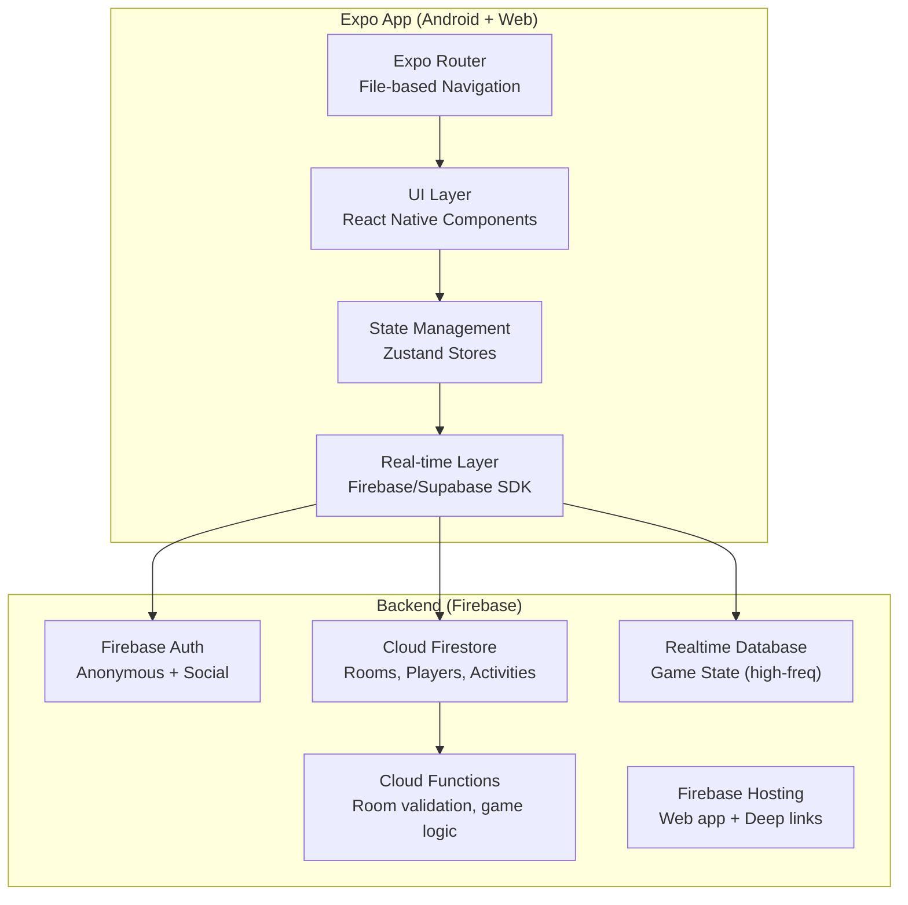

# BlitzRoom — Multiplayer Activity Room App

A real-time room-based app where users create rooms, pick activities (games, quizzes, etc.), configure settings, share invite links, and play together — targeting **Android** and **Web** first.

---

## ✅ Decisions Finalized

| Decision | Choice |
|:---|:---|
| **Backend** | Firebase (Firestore + Realtime DB + Auth + Hosting) |
| **Auth MVP** | Anonymous/guest auth (zero friction), social login later |
| **Expo SDK** | SDK 54 (Expo Go Android compatibility) |
| **App Name** | BlitzRoom (`blitzroom://`) |
| **Initial Activities** | Quiz + Truth or Dare |
| **Max Players** | 2–20 per room, admin configurable |
| **Themes** | 5 color themes (Blue, Green, Orange, Red, Purple) |
| **Persistence** | History saved for logged-in users; ephemeral for guests |
| **Testing** | Compilation checks only; user handles device testing |

---

## ~~User Review Required~~ (Resolved)

> [!IMPORTANT]
> **Backend Choice: Firebase vs Supabase**
> This decision fundamentally shapes the entire architecture. See the comparison below and let me know your preference.

| Aspect | Firebase | Supabase |
|:---|:---|:---|
| **Real-time** | Mature Firestore listeners + Realtime DB for high-frequency | Broadcast (ephemeral) + Presence + Postgres Changes |
| **Auth** | Google, Apple, Phone, Email — all built-in, deep Android integration | Google, Apple, Email, Magic Link — open-source |
| **Cost** | Pay per read/write (can spike with real-time games) | Pay per compute/storage (more predictable) |
| **Hosting** | Firebase Hosting (free tier for web) | Supabase Edge Functions + any static host |
| **Push Notifications** | FCM built-in | Requires separate service (OneSignal, Expo Push) |
| **Data Model** | NoSQL (document-based) — great for room/game state | Relational (Postgres) — great for leaderboards, history |
| **Vendor Lock-in** | High (Google ecosystem) | Low (self-hostable, open-source) |
| **Recommendation** | ✅ **Recommended for this app** — simpler setup, native Android push notifications, faster prototyping for room-based real-time apps | Great alternative if you want SQL and data ownership |

> [!IMPORTANT]
> **Authentication Strategy**
> For the MVP, I recommend starting with **anonymous/guest auth** (auto sign-in, no login screen) so anyone can create or join a room instantly. We can layer in Google Sign-In, email/password, etc. later for persistent profiles and history. Does this approach work for you?

> [!IMPORTANT]
> **App Name & Branding**
> I'll use **"BlitzRoom"** as the app name with the scheme `blitzroom://`. The directory is already `BlitzRoom`. Please confirm or suggest an alternative.

---

## Open Questions

> [!IMPORTANT]
> **1. Which initial activities should we ship?**
> I suggest starting with **2 activities** for the MVP to prove the plugin architecture works:
> - **Quiz** — Admin creates/selects questions, players answer in real-time, scores shown live
> - **Truth or Dare** — Simple turn-based game, admin can configure categories
>
> Are these good starting points, or do you have other activities in mind?

> [!IMPORTANT]
> **2. Max players per room?**
> What's the expected room size? This affects the real-time architecture. I'm planning for **2–20 players** by default, configurable by the admin.

> [!IMPORTANT]
> **3. Persistence requirements?**
> Should room history, scores, and past games be saved for later viewing? Or are rooms fully ephemeral (gone once everyone leaves)?

---

## Architecture Overview



### Data Model (Firestore)

```
/rooms/{roomId}
  ├── status: "waiting" | "configuring" | "active" | "finished"
  ├── code: "ABCD12"          // 6-char join code
  ├── adminId: "user123"
  ├── activityType: "quiz"
  ├── activitySettings: { ... }
  ├── maxPlayers: 10
  ├── createdAt: timestamp
  └── /players/{playerId}     // subcollection
        ├── displayName: "Player 1"
        ├── avatarColor: "#FF5733"
        ├── isReady: true
        ├── score: 0
        └── joinedAt: timestamp

/activities/{activityType}
  ├── name: "Quiz"
  ├── description: "Test your knowledge!"
  ├── icon: "brain"
  ├── minPlayers: 2
  ├── maxPlayers: 20
  └── defaultSettings: { ... }
```

### Key Tech Decisions

| Concern | Choice | Rationale |
|:---|:---|:---|
| **Framework** | Expo SDK 53 + Expo Router v4 | File-based routing, web support, typed routes |
| **Language** | TypeScript (strict) | Type safety for complex game state |
| **Styling** | React Native StyleSheet + custom theme system | Maximum cross-platform compatibility (no NativeWind needed for this scope) |
| **State** | Zustand | Lightweight, perfect for game state stores |
| **Real-time** | Firebase Firestore `onSnapshot` + Realtime DB for game events | Low-latency, proven at scale |
| **Navigation** | Expo Router (file-based) | Universal deep linking for web + Android |
| **Lists** | FlashList | 60fps player lists |
| **Icons** | `@expo/vector-icons` (MaterialCommunityIcons) | Rich icon set, zero config |
| **Animations** | `react-native-reanimated` | Smooth micro-animations, off-main-thread |
| **Sharing** | React Native `Share` API + Clipboard | Cross-platform link sharing |

---

## Project Structure

```
BlitzRoom/
├── app/                              # Expo Router — thin route wrappers
│   ├── _layout.tsx                   # Root layout (providers, theme)
│   ├── index.tsx                     # Home / Landing screen
│   ├── (auth)/
│   │   └── login.tsx                 # Optional: social login
│   ├── create/
│   │   ├── index.tsx                 # Create room → pick activity
│   │   └── [activity].tsx            # Configure activity settings
│   ├── room/
│   │   ├── [code].tsx                # Room lobby (join via code/link)
│   │   └── _layout.tsx               # Room layout wrapper
│   ├── join/
│   │   └── index.tsx                 # Join room screen (enter code)
│   └── play/
│       └── [roomId].tsx              # Active game/activity screen
├── src/
│   ├── components/                   # Shared UI components
│   │   ├── Button.tsx
│   │   ├── Card.tsx
│   │   ├── Avatar.tsx
│   │   ├── PlayerCard.tsx
│   │   ├── RoomCodeDisplay.tsx
│   │   ├── ActivityCard.tsx
│   │   └── LoadingOverlay.tsx
│   ├── features/
│   │   ├── room/                     # Room management
│   │   │   ├── hooks/
│   │   │   │   ├── useRoom.ts        # Room state subscription
│   │   │   │   ├── useRoomPlayers.ts # Players subscription
│   │   │   │   └── useRoomActions.ts # Create, join, leave, kick
│   │   │   ├── components/
│   │   │   │   ├── RoomLobby.tsx     # Lobby view with player list
│   │   │   │   ├── RoomSettings.tsx  # Admin settings panel
│   │   │   │   └── ShareRoom.tsx     # Share link/code component
│   │   │   └── roomStore.ts          # Zustand room store
│   │   ├── activities/               # Activity plugin system
│   │   │   ├── registry.ts           # Activity registry (add new activities here)
│   │   │   ├── types.ts              # Activity interface/types
│   │   │   ├── quiz/
│   │   │   │   ├── QuizGame.tsx      # Main quiz gameplay component
│   │   │   │   ├── QuizSettings.tsx  # Quiz-specific settings
│   │   │   │   ├── quizLogic.ts      # Quiz state machine
│   │   │   │   └── types.ts          # Quiz-specific types
│   │   │   └── truth-or-dare/
│   │   │       ├── TruthOrDareGame.tsx
│   │   │       ├── TruthOrDareSettings.tsx
│   │   │       ├── todLogic.ts
│   │   │       └── types.ts
│   │   └── user/                     # User/auth management
│   │       ├── hooks/
│   │       │   └── useAuth.ts
│   │       └── userStore.ts
│   ├── services/                     # Backend services
│   │   ├── firebase.ts               # Firebase initialization
│   │   ├── roomService.ts            # Room CRUD operations
│   │   └── realtimeService.ts        # Real-time subscriptions
│   ├── theme/                        # Design system
│   │   ├── colors.ts                 # Color palette
│   │   ├── typography.ts             # Font scales
│   │   ├── spacing.ts                # Spacing tokens
│   │   └── index.ts                  # Theme provider
│   ├── types/                        # Global types
│   │   ├── room.ts
│   │   ├── player.ts
│   │   └── activity.ts
│   └── utils/                        # Helpers
│       ├── generateRoomCode.ts       # Random 6-char code
│       ├── haptics.ts                # Haptic feedback
│       └── platform.ts               # Platform-specific utils
├── assets/                           # Images, fonts
├── app.json                          # Expo config
├── tsconfig.json
├── package.json
└── .env                              # Firebase config keys
```

---

## Proposed Changes — Phased Implementation

### Phase 1: Project Scaffolding & Design System [x]

- [x] **Project initialization**: Scaffolded Expo project, configured TypeScript, Expo Router, and platform targets. Installed core dependencies (`zustand`, `react-native-reanimated`, `@expo/vector-icons`, `expo-haptics`, `expo-clipboard`, `expo-sharing`).
- [x] **[app.json](file:///d:/my_projects/react_native_projects/BlitzRoom/app.json)**: Configured scheme, platforms, splash screen, icons.
- [x] **Theme system (`src/theme/`)**: Dark-mode-first design, color palette, typography (Inter), and spacing scale.

---

### Phase 2: Core Screens & Navigation [x]

- [x] **[app/_layout.tsx](file:///d:/my_projects/react_native_projects/BlitzRoom/app/_layout.tsx)**: Root layout with theme provider and stack navigator.
- [x] **[app/index.tsx](file:///d:/my_projects/react_native_projects/BlitzRoom/app/index.tsx)**: Home Screen with profile customizer and CTAs.
- [x] **[app/create/index.tsx](file:///d:/my_projects/react_native_projects/BlitzRoom/app/create/index.tsx)**: Activity Picker listing available activities.
- [x] **[app/create/[activity].tsx](file:///d:/my_projects/react_native_projects/BlitzRoom/app/create/%5Bactivity%5D.tsx)**: Dynamic activity settings form.
- [x] **[app/join/index.tsx](file:///d:/my_projects/react_native_projects/BlitzRoom/app/join/index.tsx)**: Join Room screen with code input formatting.
- [x] **[app/room/[code].tsx](file:///d:/my_projects/react_native_projects/BlitzRoom/app/room/%5Bcode%5D.tsx)**: Lobby waiting room with copy/share buttons, player cards, ready status.
- [x] **[app/play/[roomId].tsx](file:///d:/my_projects/react_native_projects/BlitzRoom/app/play/%5BroomId%5D.tsx)**: Game component runtime mount.

---

### Phase 3: Backend Integration & Local Fallback [ ]

- [x] **Firebase setup (`src/services/firebase.ts`)**: Initialize Firebase SDK client-side.
- [ ] **Auth flow (`src/features/user/`)**: Connect anonymous Firebase authentication.
- [ ] **Robust Local Fallback**:
  - Implement a fallback in `roomService.ts` that automatically switches to a fully functional in-memory database when Firebase Auth initialization fails (i.e. `isAuthenticated` is false).
  - This prevents the app from hanging on the "Creating room lobby..." screen when the Firebase console is not fully configured (e.g. Anonymous Auth is disabled).
  - Simulate real-time updates for rooms, players, and events in local fallback mode.
- [ ] **Real-time subscriptions (`src/services/realtimeService.ts`)**: Implement live Firestore listeners for rooms, players, and game state events.

---

### Phase 4: Activity Plugin System [x]

- [x] **Activity registry (`src/features/activities/registry.ts`)**: registry mapping activity IDs to their components.
- [x] **Activity interface (`src/features/activities/types.ts`)**: type definition for plugins.
- [x] **Quiz activity (`src/features/activities/quiz/`)**: Settings component, gameplay component, timer, score logic.
- [x] **Truth or Dare activity (`src/features/activities/truth-or-dare/`)**: Settings component, game state, categories.

---

### Phase 5: Deep Linking & Sharing [x]

- [x] **Deep link configuration**: Configured app scheme `blitzroom://`.
- [x] **Share functionality**: Share invitation messages with deep links and copy to clipboard.

---

### Phase 6: Polish & Premium Feel [x]

- [x] **Animations**: Page transitions, status updates.
- [x] **Haptics**: Button press, error, and success feedback.
- [x] **Error handling**: Handle room not found, invalid codes, or empty fields.
- [x] **Local DB Hot Reload persistence**: Added global object binding in `roomService.ts` to prevent hot reloads from wiping active lobbies.

---

## Verification Plan

### Automated Tests
```bash
# TypeScript compilation check
npx tsc --noEmit
```

### Manual Verification (User-driven)
- Create a room on Android, join from Web (cross-platform test)
- Share link from Android → open on Web → verify deep link resolution
- Test with 2+ players joining simultaneously
- Verify real-time player list updates across all connected clients
- Test admin controls (kick, start, settings changes)
- Test network disconnection and reconnection behavior
- Verify room cleanup when all players leave

### Platform-Specific Checks
- **Android**: Deep links, haptics, share sheet, back button handling
- **Web**: URL routing, responsive layout, clipboard API, share fallback
